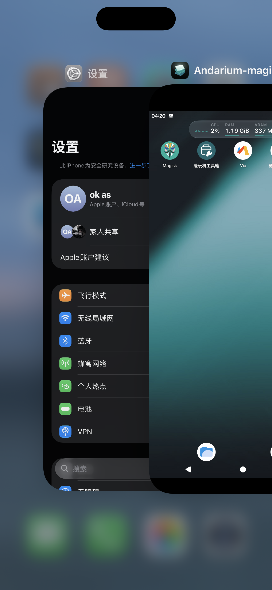

# Andarium 获取 Root
下载成品https://github.com/jxcaxtc/Andarium-root-magisk/releases
下载后自行安装面具即可获得 root 权限

请给一个 stars 吧🥺
## 结论

**Andarium 用不了内核层面的 root 管理器**，这是实测结论。

Magisk、KernelSU、APatch 这类工具的工作原理是接管内核启动、替换 init、建立 overlay 挂载。它们需要真正的 boot 分区和真正的内核启动流程。而 Andarium CONFIG_MODULES 未开，且 vermagic 也对不上 → 双重不满足所以就放弃了这条路

所以走的是另一条路：**改 guest 镜像里的 boot 分区**

## 流程

### 1. 拿到 system.img

从应用商店下载好，然后脱壳Andarium，直接进它的目录，`andarium-system/guest/system.img` 就是 guest 的系统盘。拷出来。

### 2. 解包

这个镜像是分区镜像，解开以后能拿到 6 个分区文件，其中 `boot` 是我们需要的，其余 5 个保持原样。

### 3. 修补 boot

把 `boot` 分区传到手机上，用 Magisk 选择"修补一个文件"，得到修补后的 boot。

### 4. 塞回去

把修补后的 boot 覆盖回原来的位置，重新打包成 system.img。
着重说一点修补过后的 boot 镜像必须和原 boot 镜像大小一致

### 5. 装回去

把新的 system.img 塞回 IPA 的对应位置，重新封装。因为改过包，签名失效，需要重签或用 TrollStore 之类的方式安装。

## 注意

- 镜像格式必须和原来一致，原来是 sparse 就还是 sparse，否则加载不起来。因为andarium有效验大小如果大小不一致，将不会加载 system.img
- 改过的 IPA 一定要重签，原签名必废。

